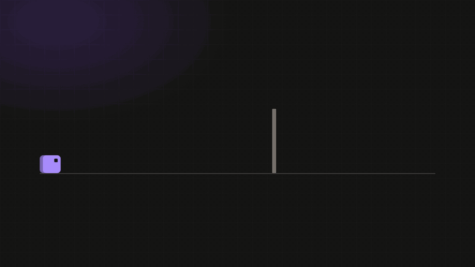
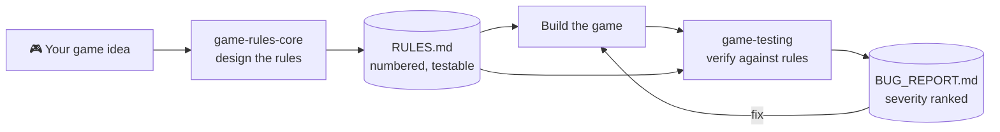

<div align="center">

# 🎮 Game-Dev-Skills

**Two Claude Skills that give any game project a rulebook and a QA pass.**

[](#-the-two-skills)
[](#-what-it-covers)
[](#-what-it-covers)
[](LICENSE)

<a href="docs/media/brag.mp4">
  
</a>

<sub>Autoplaying preview (silent). <a href="docs/media/brag.mp4">Open the full video with sound</a>.</sub>

**[▶ Rule builder demo](https://pranesh0805-s.github.io/Game-Dev-Skills/)** ·
**[▶ Animated launch demo](https://pranesh0805-s.github.io/Game-Dev-Skills/brag-demo.html)** ·
[Getting started](docs/getting-started.md) ·
[FAQ](docs/faq.md)

</div>

---

## 💡 Why this exists

Every game has its own rules, but most projects never write them down. When the rules live only in the developer's head:

- collision and physics bugs show up late,
- "does it work?" has no definition,
- testing means "I played it and it felt fine".

These skills fix that in two steps: **write the rules first, then test against them.**

---

## 🧩 The two skills

| Skill | Job | Output |
|---|---|---|
| [`game-rules-core`](skills/game-rules-core/SKILL.md) | Defines universal rules for any 2D/3D game: loop, states, collision, win/lose, scoring, genre add-ons | `RULES.md` in your project |
| [`game-testing`](skills/game-testing/SKILL.md) | Reads `RULES.md` + code, writes tests, hunts bugs | `BUG_REPORT.md` with severity ranking |

They chain: the output of the first is the input of the second.



---

## 🕹️ Try it: click to expand

<details>
<summary><b>▶ Step 1. Design the rules (<code>game-rules-core</code>)</b></summary>

Prompt Claude:

```text
Use game-rules-core. I'm building a 3D third-person endless runner in Three.js.
Create RULES.md before any code.
```

Claude identifies dimension, genre, camera and input, then produces a rules table:

| ID | Trigger | Condition | Effect | Edge case |
|---|---|---|---|---|
| R-001 | Space pressed | grounded, or ≤ 0.10 s since leaving ground | vy = 9.0 m/s | press up to 0.10 s before landing still jumps |
| R-003 | Player touches Cactus | not invulnerable | lives −1, invulnerable 1.5 s | touching during invulnerability does nothing |

More in [`examples/RULES.example.md`](examples/RULES.example.md).
</details>

<details>
<summary><b>▶ Step 2. Build the game</b></summary>

Implement using the patterns from the skill: fixed-timestep loop, explicit state machine, layered collision, one config file for physics constants. Genre add-ons (platformer, runner, shooter, puzzle, racing) are picked per project.
</details>

<details>
<summary><b>▶ Step 3. Test it (<code>game-testing</code>)</b></summary>

Prompt Claude Code in your project folder:

```text
Use game-testing on this project. Verify against RULES.md and write BUG_REPORT.md.
```

Claude maps the code, runs the checklist, writes tests, and reports findings with evidence:

```text
BUG-002  Major  Coyote time too long (violates R-001)
Steps:    1. Walk off a ledge  2. Wait 0.3 s  3. Press Space
Evidence: src/player.js:88  coyoteTime = 0.4
Fix:      set coyoteTime = 0.10
```

Full sample: [`examples/BUG_REPORT.example.md`](examples/BUG_REPORT.example.md).
</details>

<details>
<summary><b>▶ Step 4. Fix and repeat</b></summary>

Fix the bugs, re-run `game-testing`, and compare reports. Update `RULES.md` whenever a rule changes so tests never drift from the design.
</details>

---

## 📋 What it covers

<details>
<summary><b>game-rules-core</b></summary>

- Game loop: `input → update(fixed dt) → collision → state resolve → render`
- State machine: `Boot → Menu → Playing ⇄ Paused → GameOver/Win → Menu`
- Win/lose, restart, score, health, spawn/despawn, difficulty, input
- Genre add-ons: platformer, runner, shooter, puzzle, racing/3D
- Collision reference: colliders, broad/narrow phase, tunneling, layer matrix
- Hard rules: no frame-rate-bound logic, numbers not adjectives, seedable randomness
</details>

<details>
<summary><b>game-testing</b></summary>

- Ten test areas: loop, input, collision, rules, scoring, spawning, frame-rate independence, performance, robustness, determinism
- Bug checklist for web/Three.js games
- Evidence-first reporting: no claim without a test, log or code path
- Honest coverage: report lists what was **not** tested
</details>

---

## 🚀 Install

### Claude apps (Settings → Skills)
1. Open the skills settings and choose **Add → upload a skill**.
2. Upload `game-rules-core.zip`, then `game-testing.zip` (from [Releases](../../releases) or built below).

### Claude Console (API)
**Skills → Create skill**, then upload the same two zips. Skills created in the Console are for the API and do not appear in the Claude app, so add them to each place you use them.

### Claude Code
```bash
git clone https://github.com/Pranesh0805-S/Game-Dev-Skills.git
cd Game-Dev-Skills
mkdir -p ~/.claude/skills
cp -r skills/game-rules-core skills/game-testing ~/.claude/skills/
```

Per-project install: copy into `<your-project>/.claude/skills/` instead.

### Build the zips yourself
```bash
bash scripts/package.sh   # writes dist/game-rules-core.zip and dist/game-testing.zip
```
The script needs the `zip` command (Linux, macOS, WSL). Each zip has the skill folder at its root with `SKILL.md` inside.

Details: [docs/getting-started.md](docs/getting-started.md).

### Validation reports

The repository validation documents and sandbox evidence are available in [`docs/validation/`](docs/validation/):

- [Repository Validation & Sandbox Test Report](docs/validation/GAME_SKILLS_REPOSITORY_VALIDATION.md)
- [Sandbox Test Results (JSON)](docs/validation/GAME_SKILLS_SANDBOX_RESULTS.json)
- [Package Test Documentation](docs/validation/GAME_SKILLS_TEST_DOCUMENTATION.md)

**Validation scope:** Package integrity and selected documentation-demo interactions were checked. These checks do not constitute an end-to-end benchmark of the skills against an actual game project.

---

## 🗂️ Repo layout

```text
Game-Dev-Skills/
├── README.md
├── LICENSE
├── CONTRIBUTING.md
├── skills/
│   ├── game-rules-core/
│   │   ├── SKILL.md
│   │   └── references/collision.md
│   └── game-testing/
│       ├── SKILL.md
│       └── references/checklist.md
├── scripts/
│   └── package.sh              ← builds upload-ready zips into dist/
├── docs/
│   ├── index.html              ← rule builder + walkthrough (GitHub Pages home)
│   ├── brag-demo.html          ← animated launch demo (GitHub Pages)
│   ├── media/
│   │   ├── brag.gif            ← autoplaying README preview
│   │   ├── brag.mp4            ← 21 s launch video (with sound)
│   │   └── brag.jpg            ← video poster
│   ├── validation/             ← validation reports and sandbox evidence
│   │   ├── GAME_SKILLS_REPOSITORY_VALIDATION.md
│   │   ├── GAME_SKILLS_SANDBOX_RESULTS.json
│   │   └── GAME_SKILLS_TEST_DOCUMENTATION.md
│   ├── getting-started.md
│   ├── game-rules-core.md
│   ├── game-testing.md
│   ├── rules-md-spec.md
│   └── faq.md
└── examples/
    ├── RULES.example.md
    └── BUG_REPORT.example.md
```

---

## 🌐 Enable the live demos

Repo **Settings → Pages → Deploy from branch → `main` / `/docs`**. Both pages are single static files with no build step:

- `docs/index.html` → `https://pranesh0805-s.github.io/Game-Dev-Skills/`
- `docs/brag-demo.html` → `https://pranesh0805-s.github.io/Game-Dev-Skills/brag-demo.html`

The preview at the top is an animated GIF because GitHub strips JavaScript from READMEs, so anything interactive lives on the demo pages.

---

## ⚠️ Status

Early version. The skills are written and packaged but have not yet been benchmarked across many games. The example outputs in `examples/` (and shown in the video) are illustrative, not captured from a real run. Issues and PRs welcome, see [CONTRIBUTING.md](CONTRIBUTING.md).

## 📄 License

MIT. See [LICENSE](LICENSE).