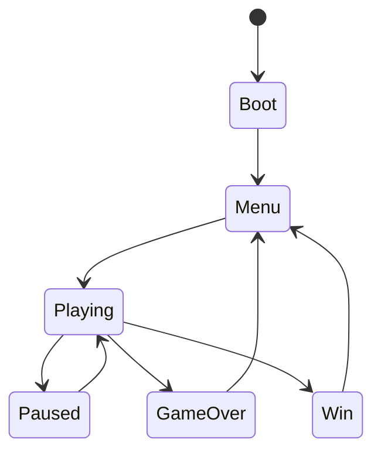

# game-rules-core

Genre-agnostic rules every game needs. Genre quirks go on top, never replace them.

**Use when:** designing or implementing mechanics, collision, physics, movement, game loop, state machines, win/lose conditions, or scoring, or reviewing a game's rule structure.

**Produces:** a `RULES.md` listing every rule in testable form ([format](rules-md-spec.md)).

## Workflow

1. Identify dimension (2D/3D), genre, camera, input scheme.
2. Define rules before code: entities, states, rules, win/lose, edge cases.
3. Implement with the patterns below.
4. Consult `references/collision.md` for collision/physics.
5. Write `RULES.md`.

## Universal structure

**Game loop**
```text
input → update(fixed dt) → collision → state resolve → render
```
Fixed timestep for physics, variable for rendering.

**State machine**

Every transition is explicit. No silent state changes.

**Rule format:** `Trigger → Condition → Effect → Edge case`

## Rules every game must define

| Area | Must answer |
|---|---|
| Win / lose | What ends the game; what resets on restart; what persists |
| Score | How it rises, caps, and is saved |
| Health / lives | Damage sources, invulnerability window, death handling |
| Spawn / despawn | Where, when, limits, cleanup |
| Difficulty | What scales and how fast |
| Input | Simultaneous input, buffering, rebinding, pause behavior |

## Genre add-ons

| Genre | Add |
|---|---|
| Platformer | gravity, variable jump, coyote time (~100 ms), jump buffer (~100 ms), one-way platforms, moving-platform carry, fall-death plane |
| Runner / endless | speed ramp, guaranteed-passable spawn spacing, seed |
| Shooter | fire rate, projectile lifetime, hit registration, ammo/reload |
| Puzzle | deterministic state, undo, solvability check |
| Racing / 3D | checkpoints, lap validation, anti-shortcut, camera collision |

## Hard rules

- Never tie gameplay logic to frame rate.
- Never let an entity leave playable bounds without a defined outcome.
- Every rule has a number (units/second, not "fast").
- Randomness must be seedable.

## Collision reference (`references/collision.md`)

- Collider choice per 2D/3D need
- Pipeline: broad phase → narrow phase → resolve → events
- Classic bugs: tunneling, corner snagging, ground jitter, stuck in geometry, moving platforms, trigger vs solid
- Layer matrix template
- Physics constants to keep in one config
