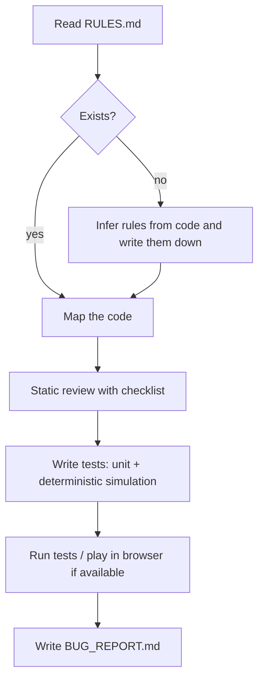

# game-testing

Systematic QA and bug-hunting for simple 2D/3D games, especially web and Three.js games.

**Use when:** asked to test, playtest, QA, debug, or find bugs in a game, or verify it against `RULES.md`.

**Produces:** tests (where possible) and a severity-ranked `BUG_REPORT.md`.

## Workflow

## Test categories

| Category | Examples |
|---|---|
| Core loop | start, pause, resume, restart, game over, win |
| Input | simultaneous keys, held across pause, rapid taps, window blur |
| Collision / physics | tunneling, corner snag, edge standing, moving platforms, void fall |
| Rules | every `RULES.md` row has at least one test |
| Scoring / save | no double count, reset on restart, corrupt localStorage |
| Spawning | limits, passability, cleanup, memory growth |
| Frame-rate independence | simulate 30 / 60 / 144 FPS, same outcome |
| Performance | frame time, entity growth, leaks, draw calls |
| Robustness | resize, tab switch, rapid restart, mobile viewport |
| Determinism | same seed + same inputs = same result |

## Bug report format

| Field | Content |
|---|---|
| ID / Title | `BUG-001 Short title` |
| Severity | Critical (crash, soft-lock, progress loss) · Major (rule broken) · Minor (visual, feel) · Polish |
| Steps | numbered, exact |
| Expected vs Actual | one line each |
| Evidence | file:line, console error, failing test |
| Suggested fix | one or two lines |

The report ends with a severity count table and a **not tested** list.

## Hard rules

- No bug claim without evidence.
- Never say something works if it was not run; say "reviewed, not executed".
- Prefer deterministic tests over "felt fine".
- Do not change gameplay code unless asked. Report first, fix on request.

## Checklist (`references/checklist.md`)

Covers game loop and state, input, collision and physics, spawning and memory (including Three.js `dispose()`), scoring and save, and web specifics (canvas DPR, audio gesture, rAF teardown, mobile).
